# 第二阶段测试用例


##  测试环境与前置条件

|  |  |
|---|---|
| 服务地址 | `http://127.0.0.1:8000/docs` |
| 数据库 | MongoDB，默认 `mongodb://127.0.0.1:27017/`，库名 `survey_system_db` |
| 启动命令 | `python -m uvicorn main:app --reload` |
| 鉴权方式 | Swagger 右上角 Authorize，输入用户名/密码，或手动带 `Authorization: Bearer <token>` |
| 数据迁移 | 先执行 `python scripts/migrate_phase2.py --apply` |

> 说明：第二阶段规定“已发布问卷的题目结构冻结”，因此大部分“改题/加题”用例都要求问卷**未发布**；涉及已发布问卷的用例专门验证409拦截。
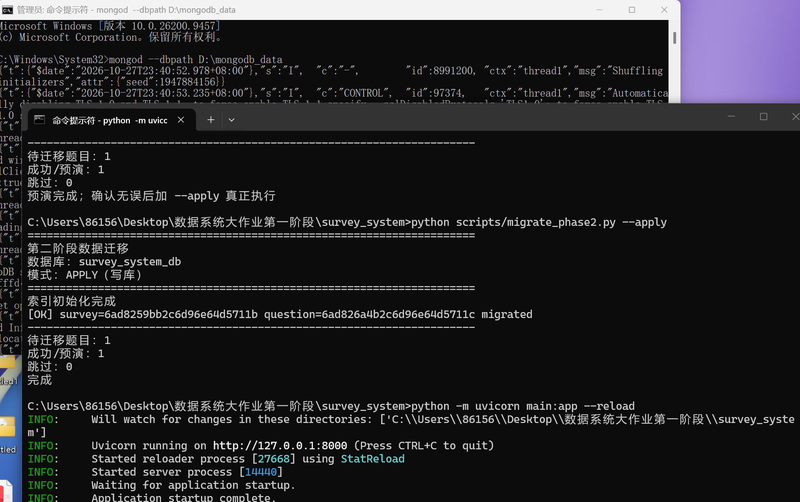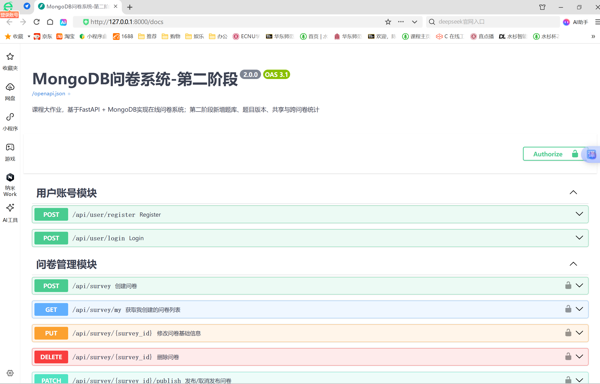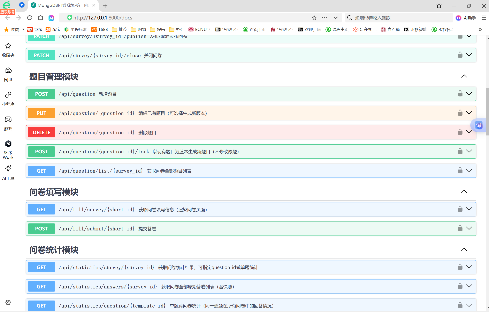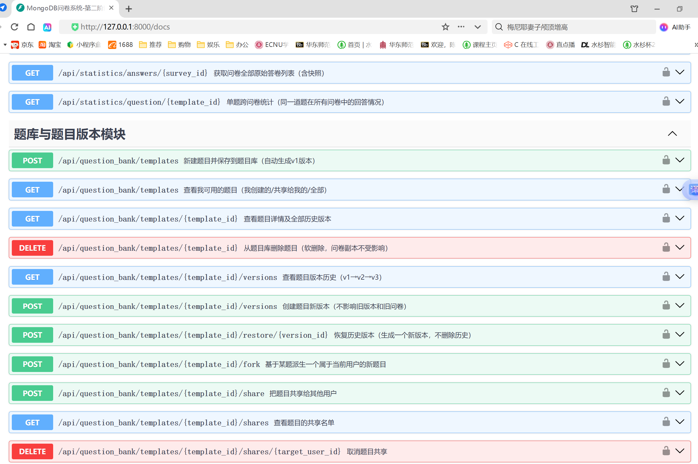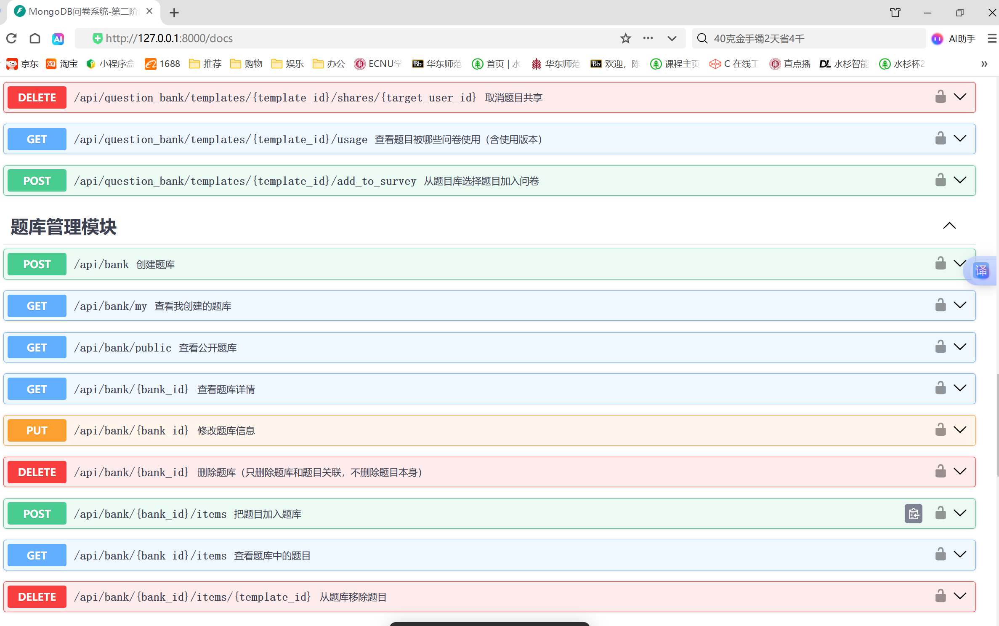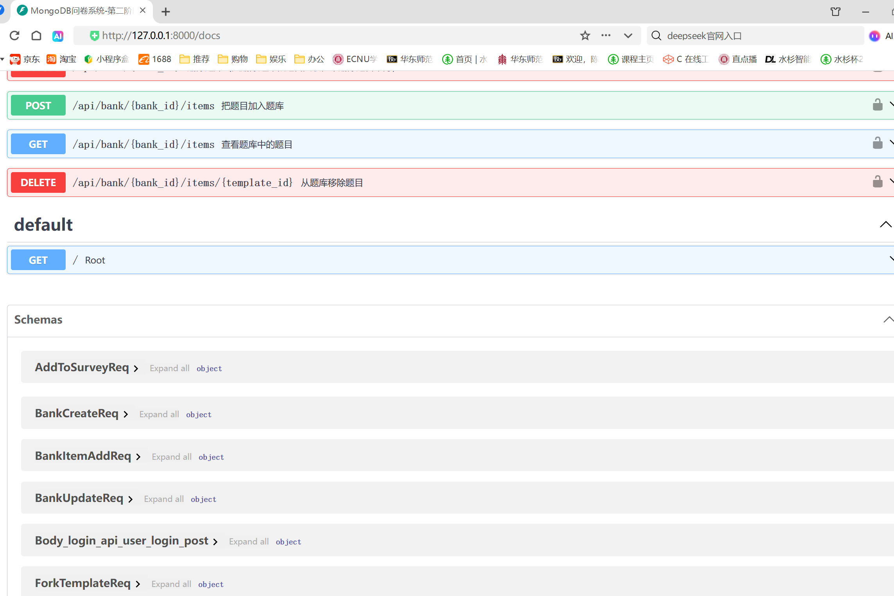![截图]
---

## 1. 测试用例总表

| 编号 | 模块 | 测试点 | 预期结果 |
|---|---|---|---|
| P2-T01 | 题库 | 创建题库 | 200，返回 `bank_id` |
| P2-T02 | 题库 | 保存题目到题库并生成 v1 | 200，返回 `template_id`、`version_id`、`current_version_no=1` |
| P2-T03 | 题库 | 从题库选题加入问卷 | 200，问卷中出现题目，`template_id/version_id` 正确 |
| P2-T04 | 共享 | 把题目共享给其他用户 | 200，共享名单出现目标用户 |
| P2-T05 | 共享 | 被共享用户查看并使用题目 | 200，`scope=shared` 可见，可加入自己的问卷 |
| P2-T06 | 共享 | 被共享用户修改原题模板 | 403，提示只有创建者可以操作 |
| P2-T07 | 共享 | 被共享用户派生自己的题目 | 200，新模板 owner 为自己，`parent_template_id` 指向原题 |
| P2-T08 | 共享 | 取消共享后不能再使用 | 取消成功；共享列表为空；再加入问卷返回 403 |
| P2-T09 | 版本 | 创建题目新版本 | 200，`version_no` 递增，旧版本仍在 |
| P2-T10 | 版本 | 查看版本历史 | 200，按版本号升序返回 v1/v2/v3 |
| P2-T11 | 版本 | 恢复旧版本 | 200，生成新版本号，`restored_from_version_id` 指向旧版本 |
| P2-T12 | 版本 | 不同问卷使用不同版本 | 两份问卷题目内容/版本号互不影响 |
| P2-T13 | 冻结 | 已发布问卷修改题目 | 409，题目内容不变 |
| P2-T14 | 冻结 | 已发布问卷删除题目 | 409，题目仍存在 |
| P2-T15 | 冻结 | 已发布问卷新增题目 | 409 |
| P2-T16 | 派生 | 已发布问卷 fork 新题到新问卷 | 200，原题不变，新题进入目标问卷 |
| P2-T17 | 使用情况 | 查看题目被哪些问卷使用 | 200，返回问卷列表及使用版本 |
| P2-T18 | 跨问卷统计 | 数字题跨问卷统计 | `total_submit`、`avg/min/max`、`by_survey` 正确 |
| P2-T19 | 跨问卷统计 | 多选题跨问卷统计 | 各选项计数正确，未选项为 0 |
| P2-T20 | 权限 | 非创建者查看跨问卷统计 | 403 |
| P2-T21 | 回归 | 第一阶段功能回归 | 注册登录、问卷、题目、提交、按问卷统计均正常 |
| P2-T22 | 迁移 | 第一阶段旧题目/旧答卷迁移 | 旧题目获得模板/版本，旧快照补字段，跨问卷统计可查到 |

---

## 2. 详细测试步骤

### P2-T01 创建题库

**前置条件**：`teacher` 已登录。

**步骤**：

1. 调用 `POST /api/bank`；
2. 请求体：

```json
{
  "name": "常用人口学题目",
  "description": "团队共用题库",
  "is_public": false
}
```

**预期输出**：

```json
{
  "code": 0,
  "msg": "题库创建成功",
  "data": {
    "bank_id": "...",
    "name": "常用人口学题目",
    "item_count": 0
  }
}
```

**检查点**：返回 `bank_id`；`GET /api/bank/my` 能看到该题库。

**实际结果/截图**：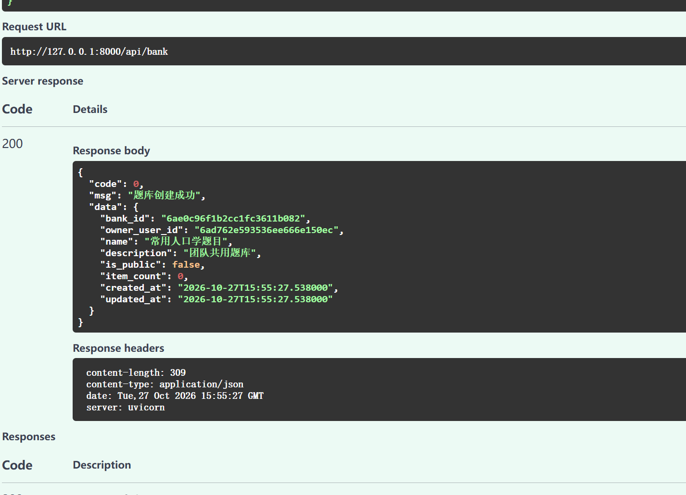

---

### P2-T02 保存题目到题库并生成 v1

**前置条件**：已取得 `bank_id`。

**步骤**：

1. 调用 `POST /api/question_bank/templates`；
2. 请求体：

```json
{
  "question_title": "你的年龄",
  "question_type": "number_fill",
  "is_required": true,
  "num_min": 0,
  "num_max": 120,
  "num_must_int": true,
  "bank_id": "<P2-T01 的 bank_id>"
}
```

**预期输出**：

- `code=0`；
- `data.template_id`、`data.version_id` 均存在；
- `data.template.current_version_no=1`；
- `GET /api/bank/{bank_id}/items` 能看到该题。

**实际结果/截图**：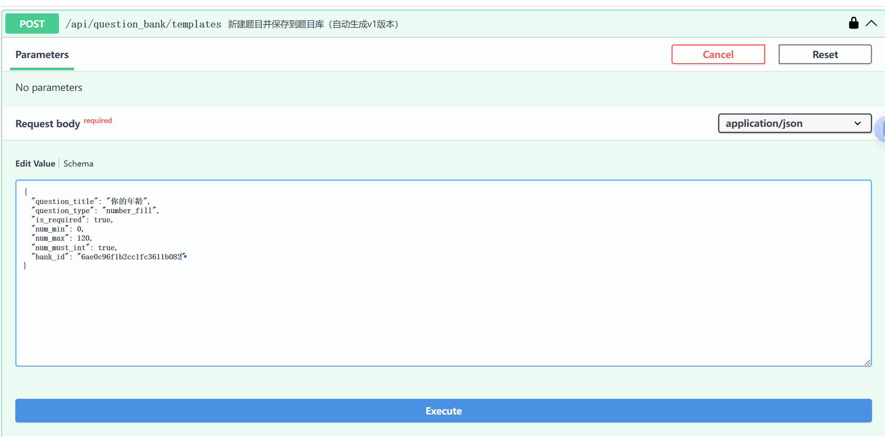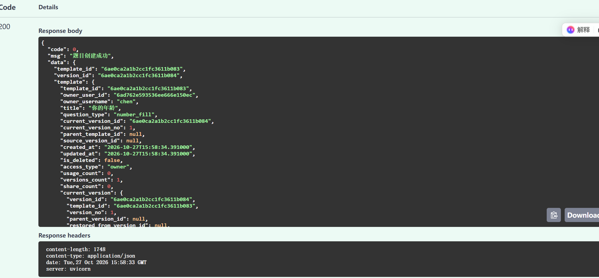

---

### P2-T03 从题库选题加入问卷

**前置条件**：

- `teacher` 已创建一份**未发布**问卷，记 `survey_id`；
- 已取得 P2-T02 的 `template_id`。

**步骤**：

1. 调用 `POST /api/question_bank/templates/{template_id}/add_to_survey`；
2. 请求体：

```json
{
  "survey_id": "<survey_id>"
}
```

**预期输出**：

```json
{
  "code": 0,
  "msg": "题目已加入问卷",
  "data": {
    "question_id": "...",
    "survey_id": "...",
    "template_id": "...",
    "version_id": "...",
    "version_no": 1,
    "question_title": "你的年龄"
  }
}
```

**检查点**：

- `GET /api/question/list/{survey_id}` 能看到该题；
- 题目文档含 `template_id/version_id/version_no/source=question_bank`。

**实际结果/截图**：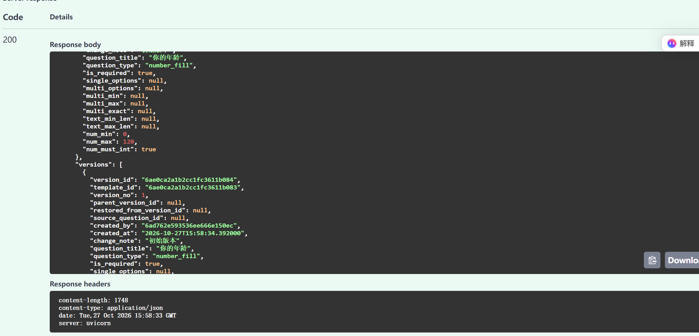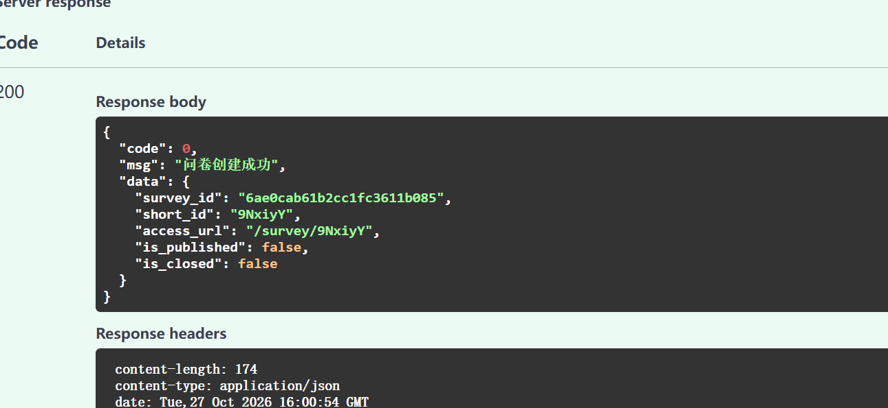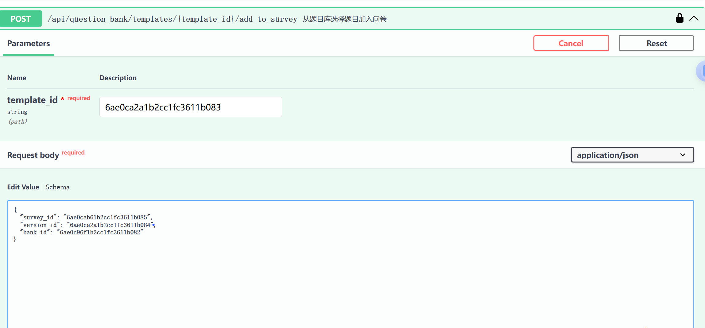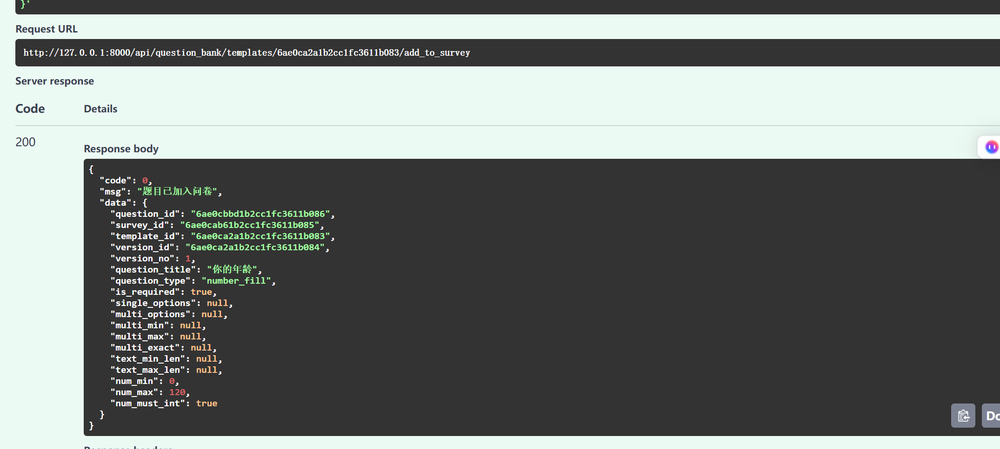

---

### P2-T04 把题目共享给其他用户

**前置条件**：`teacher` 已创建题目模板；`student` 已注册。

**步骤**：

1. 调用 `POST /api/question_bank/templates/{template_id}/share`；
2. 请求体：

```json
{
  "target_username": "student",
  "can_use": true
}
```

**预期输出**：

- `code=0`；
- `shared_with_username=student`；
- `GET /api/question_bank/templates/{template_id}/shares` 能看到 student。

**异常测试**：

- 共享给自己 → 400；
- 共享给不存在的用户 → 404；
- 非题目创建者调用 → 403。

**实际结果/截图**：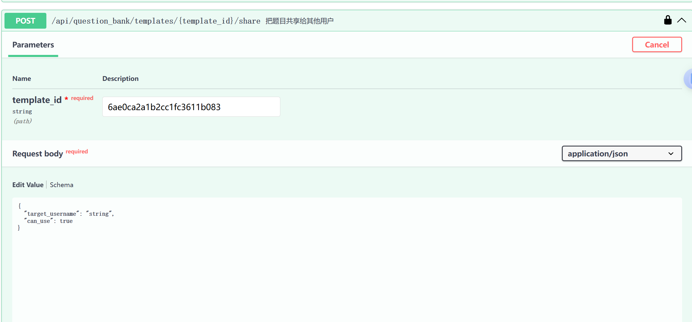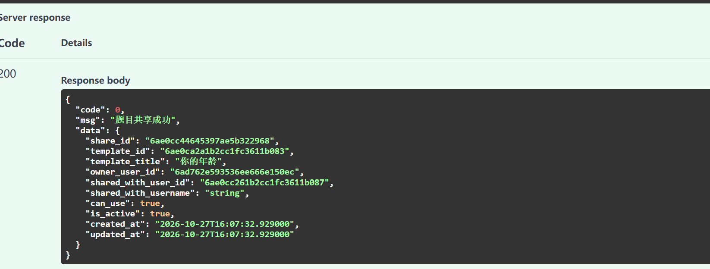

---

### P2-T05 被共享用户查看并使用题目

**前置条件**：P2-T04 已执行；`student` 已登录。

**步骤**：

1. `GET /api/question_bank/templates?scope=shared`；
2. 创建一份 student 的未发布问卷；
3. `POST /api/question_bank/templates/{template_id}/add_to_survey`，传入 student 的 `survey_id`。

**预期输出**：

- 第 1 步列表包含该题，`access_type=shared`；
- 第 3 步成功，题目加入 student 问卷；
- student 不能修改原题模板。

---

### P2-T06 被共享用户不能修改原题模板

**前置条件**：P2-T05 已执行。

**步骤**：

1. 用 `student` 的 token 调用 `POST /api/question_bank/templates/{template_id}/versions`；
2. 请求体：

```json
{
  "question_title": "学生试图修改老师题目"
}
```

**预期输出**：

- HTTP 403；
- 提示“只有题目创建者可以执行该操作”。

---

### P2-T07 被共享用户派生自己的题目

**前置条件**：P2-T05 已执行。

**步骤**：

1. 用 `student` 的 token 调用 `POST /api/question_bank/templates/{template_id}/fork`；
2. 请求体：

```json
{
  "title": "学生自己的年龄题"
}
```

**预期输出**：

- HTTP 200；
- 返回新的 `template_id`；
- `owner_username=student`；
- `parent_template_id` 等于原题模板 id；
- 原题内容不变。

---

### P2-T08 取消共享后不能再使用

**前置条件**：P2-T04 已执行。

**步骤**：

1. `teacher` 调用 `DELETE /api/question_bank/templates/{template_id}/shares/{student_user_id}`；
2. `student` 再查 `GET /api/question_bank/templates?scope=shared`；
3. `student` 尝试把该题加入一份新问卷。

**预期输出**：

- 取消成功；
- 共享列表为空；
- 第 3 步返回 403；
- 之前已经加入 student 问卷的题目副本仍然存在（不影响历史问卷）。

---

### P2-T09 创建题目新版本

**前置条件**：已有一个题目模板 v1。

**步骤**：

1. 调用 `POST /api/question_bank/templates/{template_id}/versions`；
2. 请求体：

```json
{
  "question_title": "你的年龄（新版）",
  "num_max": 150,
  "change_note": "调整上限"
}
```

**预期输出**：

- `version_no=2`；
- `parent_version_id` 等于 v1 的 `version_id`；
- `num_max=150`；
- v1 仍然存在且内容不变。

**实际结果/截图**：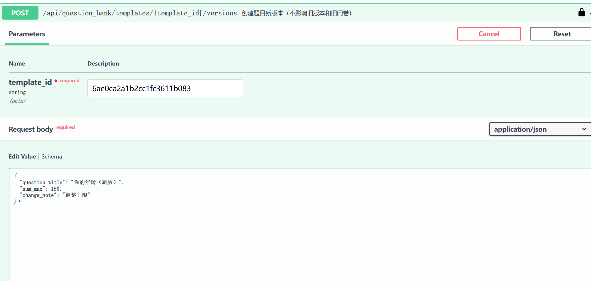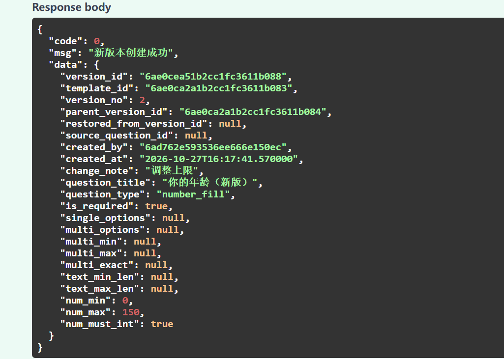

---

### P2-T10 查看版本历史

**步骤**：

1. 调用 `GET /api/question_bank/templates/{template_id}/versions`。

**预期输出**：

```json
{
  "code": 0,
  "data": {
    "template_id": "...",
    "current_version_no": 2,
    "versions": [
      {"version_no": 1, "question_title": "你的年龄"},
      {"version_no": 2, "question_title": "你的年龄（新版）"}
    ]
  }
}
```

**检查点**：版本按 `version_no` 升序；`parent_version_id` 能串成链。

**实际结果/截图**：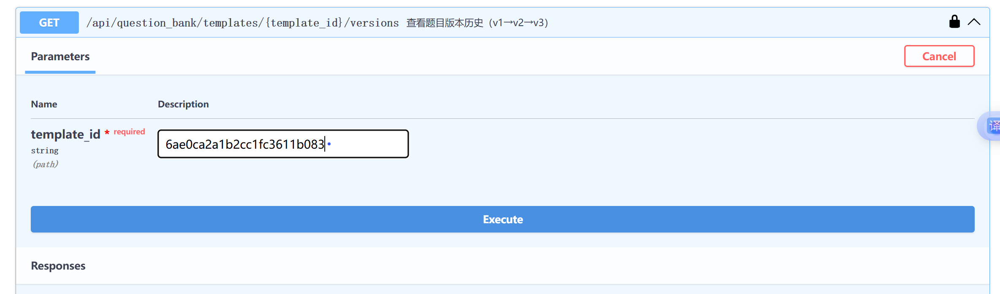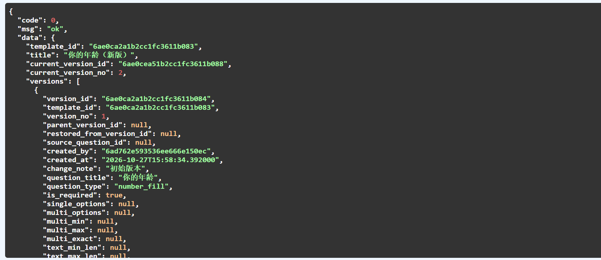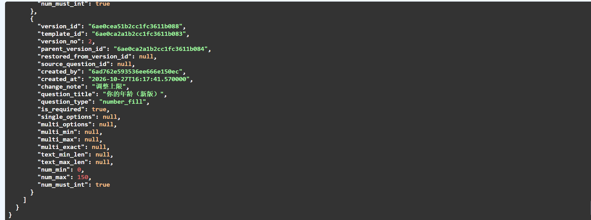

---

### P2-T11 恢复旧版本

**前置条件**：已有 v1、v2。

**步骤**：

1. 调用 `POST /api/question_bank/templates/{template_id}/restore/{v1_id}`。

**预期输出**：

- 返回 `version_no=3`；
- `restored_from_version_id` 等于 v1 的 id；
- 内容恢复为 v1 的内容；
- v1、v2 均未删除；
- 模板 `current_version_no=3`。

**实际结果/截图**：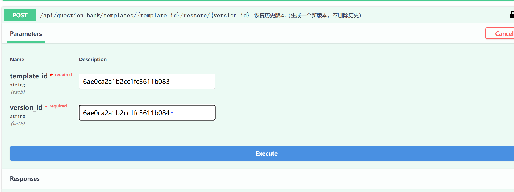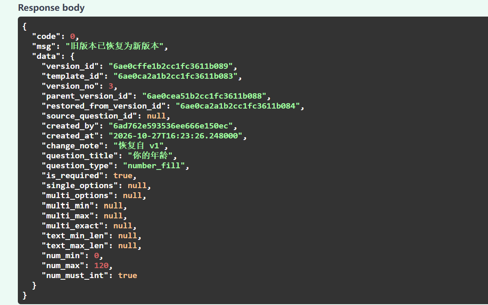

---

### P2-T12 不同问卷使用不同版本

**前置条件**：

- 题目模板 v1；
- 两份未发布问卷 A、B；
- v1 已加入 A、B。

**步骤**：

1. 把 B 中的题目用 `PUT /api/question/{question_id}?create_new_version=true` 修改标题或参数；
2. 分别查询 A、B 的题目列表。

**预期输出**：

- B 的题目为新版本（`version_no=2`，内容为新内容）；
- A 的题目仍是 v1（`version_no=1`，内容为旧内容）；
- `GET .../usage` 返回 2 份问卷，使用版本分别为 1、2。

**实际结果/截图**：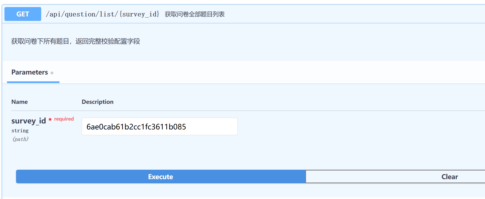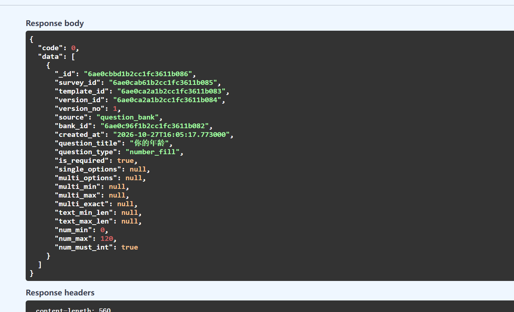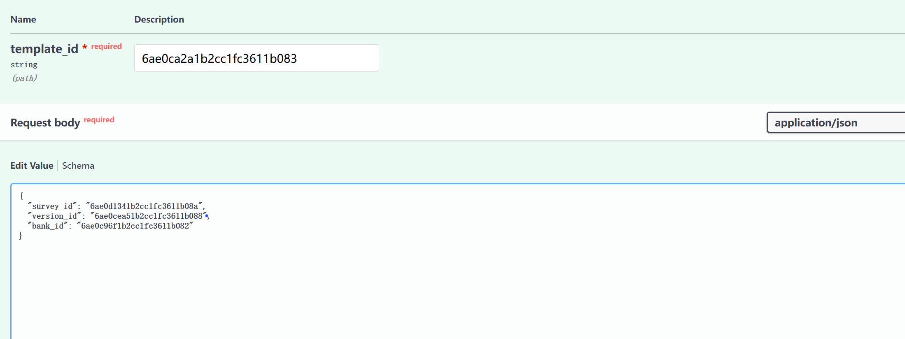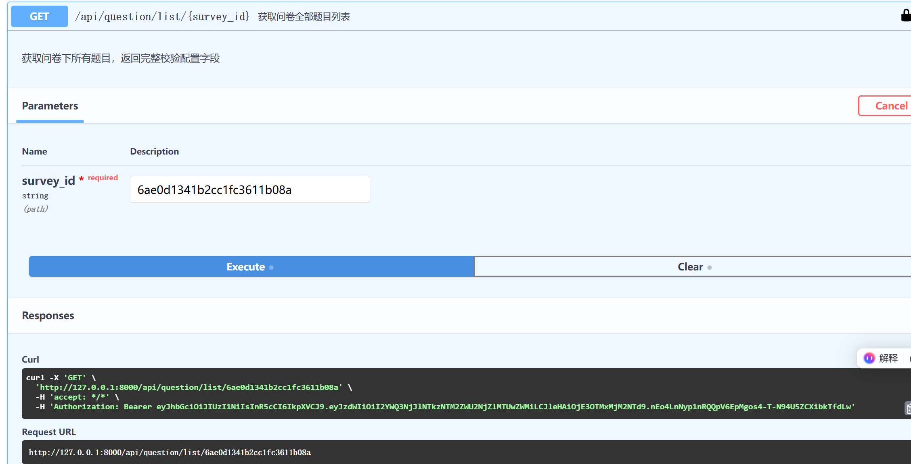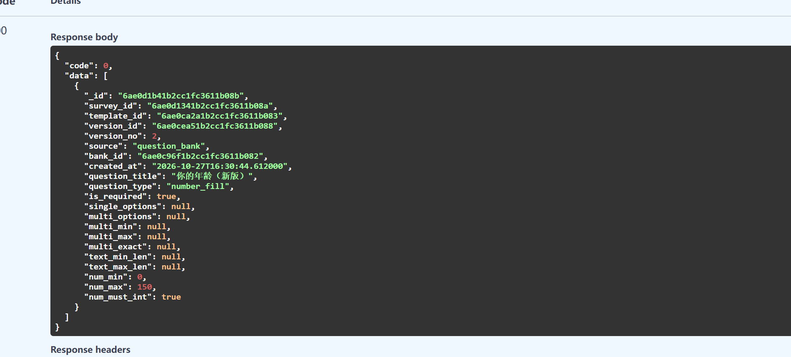

---

### P2-T13 已发布问卷修改题目被拦截

**前置条件**：问卷已发布，包含一道题。

**步骤**：

1. 调用 `PUT /api/question/{question_id}`；
2. 请求体：

```json
{
  "question_title": "试图修改"
}
```

**预期输出**：

- HTTP 409；
- 题目内容保持不变；
- 提示问卷已发布，题目不可修改。

**实际结果/截图**：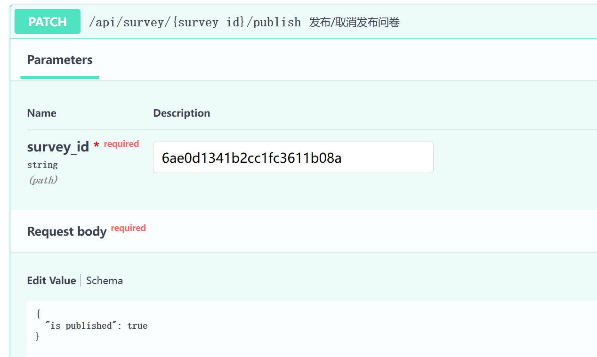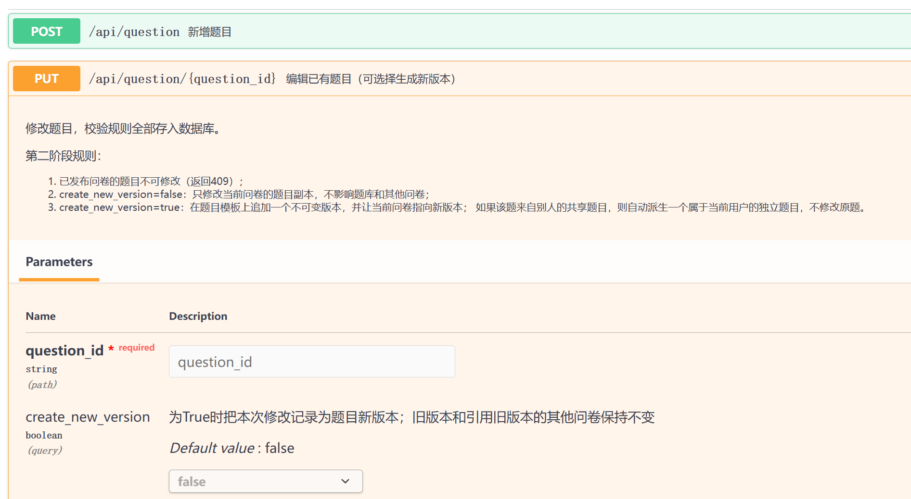

---

### P2-T14 已发布问卷删除题目被拦截

**步骤**：

1. 调用 `DELETE /api/question/{question_id}`。

**预期输出**：

- HTTP 409；
- 题目仍然存在。


---

### P2-T15 已发布问卷新增题目被拦截

**步骤**：

1. 调用 `POST /api/question`，传入已发布问卷的 `survey_id`。

**预期输出**：

- HTTP 409；
- 问卷题目数量不变。


---

### P2-T16 已发布问卷 fork 新题到新问卷

**前置条件**：

- 问卷 A 已发布，包含“去年年龄题”；
- 已创建未发布问卷 B。

**步骤**：

1. 调用 `POST /api/question/{A中的question_id}/fork`；
2. 请求体：

```json
{
  "target_survey_id": "<B 的 survey_id>",
  "new_title": "今年年龄题"
}
```

**预期输出**：

- HTTP 200；
- B 中出现“今年年龄题”；
- A 中“去年年龄题”完全不变；
- 新题有新的 `template_id/version_id`。

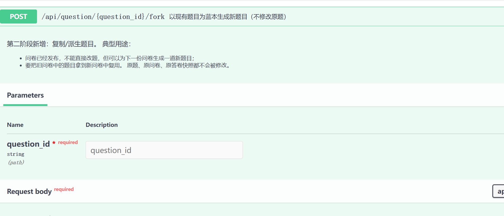
---

### P2-T17 查看题目被哪些问卷使用

**前置条件**：同一题目模板被至少两份问卷使用。

**步骤**：

1. 调用 `GET /api/question_bank/templates/{template_id}/usage`。

**预期输出**：

```json
{
  "code": 0,
  "data": {
    "template_id": "...",
    "template_title": "你的年龄",
    "current_version_no": 2,
    "total_surveys": 2,
    "total_question_instances": 2,
    "usage": [
      {
        "survey_id": "...",
        "survey_title": "问卷A",
        "is_published": true,
        "versions": [1],
        "question_instances": ["..."]
      }
    ]
  }
}
```

**检查点**：返回问卷标题、发布状态、使用版本；非创建者调用返回 403。

**实际结果/截图**：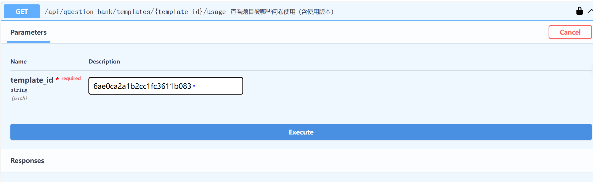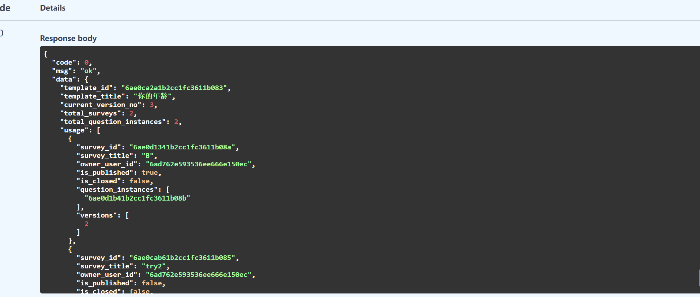

---

### P2-T18 数字题跨问卷统计

**前置条件**：

- 题目“你的年龄”（数字填空，0~120，整数）v1；
- 两份已发布问卷各使用该题；
- 两名/同一名用户分别提交 20 和 30。

**步骤**：

1. 调用 `GET /api/statistics/question/{template_id}`。

**预期输出**：

```json
{
  "code": 0,
  "data": {
    "template_id": "...",
    "question_title": "你的年龄",
    "question_type": "number_fill",
    "total_submit": 2,
    "total_answer": 2,
    "overall": {
      "count": 2,
      "avg": 25.0,
      "min": 20.0,
      "max": 30.0
    },
    "by_survey": [
      {"survey_title": "问卷一", "submit_count": 1, "stat": {"avg": 20.0}},
      {"survey_title": "问卷二", "submit_count": 1, "stat": {"avg": 30.0}}
    ]
  }
}
```

**检查点**：

- `total_submit=2`；
- 总体平均值为 25；
- `by_survey` 能按问卷拆分；
- 加 `?version_id=<v1>` 只统计 v1。

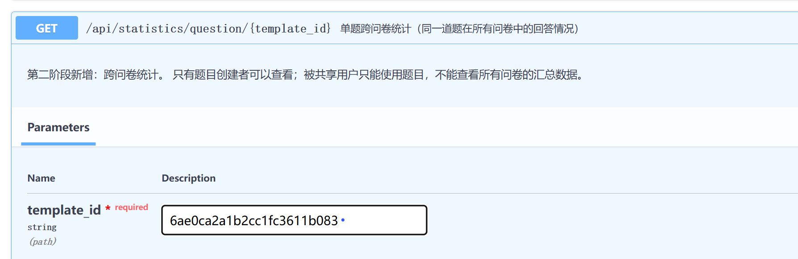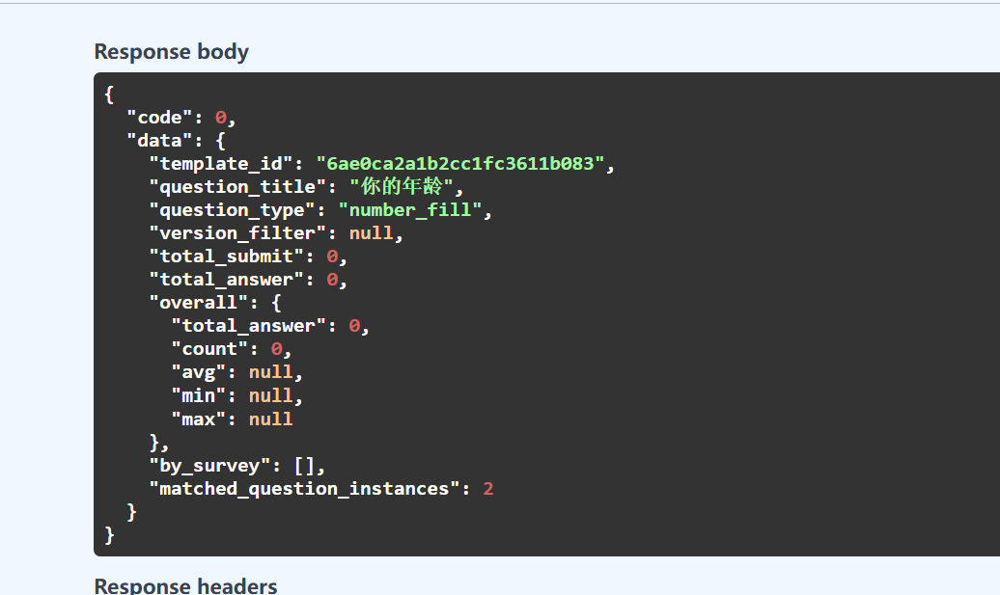

---

### P2-T19 多选题跨问卷统计

**前置条件**：

- 题目“你喜欢的水果”，多选，选项：苹果/香蕉/西瓜；
- 一份问卷使用该题并收到答案 `["苹果","香蕉"]`。

**步骤**：

1. 调用 `GET /api/statistics/question/{template_id}`。

**预期输出**：

```json
{
  "overall": {
    "total_answer": 1,
    "option_count": {
      "苹果": 1,
      "香蕉": 1,
      "西瓜": 0
    },
    "option_percent": {
      "苹果": 100.0,
      "香蕉": 100.0,
      "西瓜": 0
    }
  }
}
```

**检查点**：未选项也返回 0，方便前端画图。

---

### P2-T20 非创建者查看跨问卷统计

**步骤**：

1. 用非题目创建者的 token 调用 `GET /api/statistics/question/{template_id}`。

**预期输出**：

- HTTP 403；
- 提示只有题目创建者可以查看跨问卷统计。

---

### P2-T21 第一阶段功能回归

**步骤**：

1. 注册/登录；
2. 创建问卷；
3. 新增单选、多选、文本、数字题；
4. 发布问卷；
5. 提交合法答卷；
6. 查看按问卷统计 `GET /api/statistics/survey/{survey_id}`；
7. 查看原始答卷 `GET /api/statistics/answers/{survey_id}`。

**预期输出**：

- 全部接口与第一阶段一致；
- 提交后 `total_submit` 增加；
- 单选/多选/文本/数字统计均正常；
- 跳转规则接口和填写页仍返回 `jump_rules`。

---

### P2-T22 第一阶段旧数据迁移

**前置条件**：

- 数据库中存在第一阶段旧题目和旧答卷；
- 已备份数据库（建议）。

**步骤**：

1. 预演：

```bat
python scripts/migrate_phase2.py
```

2. 确认输出后执行：

```bat
python scripts/migrate_phase2.py --apply
```

3. 用 MongoDB Compass 或 shell 查看：

```javascript
db.questions.findOne({ template_id: { $exists: true } })
db.answers.findOne({ "question_snapshot.template_id": { $exists: true } })
```

**预期输出**：

- 旧题目补上 `template_id/version_id/version_no=1/source=phase1`；
- 旧答卷快照补上 `template_id/version_id/version_no`；
- 旧问卷、旧统计、旧跳转仍可用；
- 重复执行不会重复创建版本。


结论：第二阶段功能满足需求变更，第一阶段功能回归通过。
```
